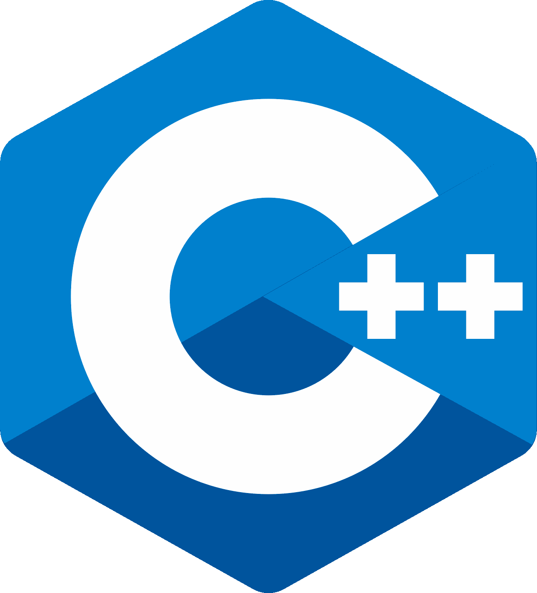

---

## Current Projects

<table>
    <tr>
        <td>
          Zichichi Mirko,
           
          <b> IOTA</b>,
          <i> The monorepo for the software that allows you to run the IOTA DLT and related tools. I contributed to the development of the core software of the DLT node, with particular focus on the whole process of executing transactions and system operations implemented in Move, including the genesis and migration tooling for the transition from IOTA Stardust to IOTA Rebased, the Move framework, the execution layer and account abstraction. </i> 2024-2026.
           
          <b>Rust</b> 
          <b>Move</b> 
        </td>
        <td>
          
        </td>
    </tr>
    <tr>
        <td>
          Zichichi Mirko, Reutov Valerii, Pap Levente, Botnar Pavlo,
           
          <b>Abstract IOTA Accounts</b>,
          <i> Account abstraction for IOTA: smart-contract-based authentication of addresses, where Move authenticator functions decide whether a transaction sent from an abstract account is authorized. Specified in IIP-0009 and implemented in the IOTA node and Move framework, together with example accounts, such as a group account authenticated through Groth16 zero-knowledge proofs of membership in a Lean Incremental Merkle Tree. </i> 2026.
           
          <b>Move</b> 
          <b>Rust</b> 
        </td>
        <td>
          
          
          
        </td>
    </tr>
    <tr>
        <td>
          Zichichi Mirko, Reutov Valerii, Pap Levente,
           
          <b>IOTA Improvement Proposals</b>,
          <i> Standards for the IOTA technology stack: IIP-0005 Move View Functions, a standardized interface for application-specific queries to on-chain state; IIP-0009 Abstract IOTA Accounts; and IIP-0010 Package Metadata, an immutable on-chain object that provides trusted metadata about Move packages during execution. </i> 2025-2026.
           
          <b>Move</b> 
        </td>
        <td>
          
        </td>
    </tr>
    <tr>
        <td>
          Zichichi Mirko,
           
          <b>Move CTF Workshop</b>,
          <i> A hands-on, capture-the-flag style workshop to learn Move on IOTA in five challenges, from writing a first Move package to building and exploiting an account-abstraction authenticator. </i> June 2026.
           
          <b>Move</b> 
        </td>
        <td>
          
        </td>
    </tr>
    <tr>
        <td>
          Zichichi Mirko,
           
          <b> Hornet Move </b>,
          <i> Proof-of-Concept Move Smart Contract Platform for IOTA Stardust, a modification of the original IOTA Hornet Node software. </i> 2023.
           
          <b>Rust</b> 
          <b>Go</b> 
          <b>Move</b> 
        </td>
        <td>
          
        </td>
    </tr>
</table>

## PhD Projects

<table>
    <tr>
        <td>
          Zichichi Mirko,
           
          <b> NFTicket for the Metaverse</b>,
          <i> Proof-of-concept implementation of an NFT that performs an Anonymous Credentials Verification before minting a Ticket.</i> March 2023.
           
          <b>Solidity</b> 
          <b>JavaScript</b> 
        </td>
        <td>
          
        </td>
    </tr>
    <tr>
        <td>
          Zichichi Mirko,
           
          <b>[desp3d] The PhD Thesis Software Repository</b>,
          <i> A set of software modules that support the work behind the PhD thesis.</i> May 2022.
           
          <b>Solidity</b> 
          <b>JavaScript</b> 
          <b>Rust</b> 
        </td>
        <td>
          
        </td>
    </tr>
    <tr>
        <td>
          Zichichi Mirko,
           
          <b>k-DaO</b>,
          <i> Implementation of a k-DAO in Ethereum that governs the exchange of data with an aggregator.</i> May 2022.
           
          <b>Solidity</b> 
          <b>JavaScript</b> 
          <b>Python</b> 
        </td>
        <td>
          
        </td>
    </tr>
    <tr>
        <td>
          Zichichi Mirko,
           
          <b>TruDaMul Smart Contracts</b>,
          <i> TruDaMul is a decentralized application that combines the use of Distributed Ledger Technologies and Decentralized File Storage, mostly for verifying the correct behavior of all the participants and incentivizing them in Data Mule-based communications.</i> August 2021.
           
          <b>Solidity</b> 
          <b>JavaScript</b> 
          <b>Python</b> 
        </td>
        <td>
          
        </td>
    </tr>
    <tr>
        <td>
          Zichichi Mirko,
           
          <b>Reference Software for ISO/IEC 21000-23 Smart Contracts for Media</b>,
          <i> Implementation of the standard specification composed of conversion modules, smart contracts, a demo and APIs.</i> July 2021.
           
          <b>Solidity</b> 
          <b>JavaScript</b> 
          <b>Python</b> 
        </td>
        <td>
          
          
        </td>
    </tr>
    <tr>
        <td>
          Zichichi Mirko,
           
          <b>IHiBO</b>,
          <i> Intelligent Human-input-based Blockchain Oracle: a cross-chain oracle that enables the execution and traceability of formal argumentation and negotiation processes involving human experts.</i> June 2021.
           
          <b>Solidity</b> 
          <b>JavaScript</b> 
          <b>Python</b> 
        </td>
        <td>
          
        </td>
    </tr>
    <tr>
        <td>
          Zichichi Mirko,
           
          <b>Hypercube DAO Contracts</b>,
          <i> Implementation of a DAO in Ethereum that governs a P2P network of nodes maintaining a Distributed Hash Table.</i> May 2021.
           
          <b>Solidity</b> 
          <b>JavaScript</b> 
          <b>Python</b> 
        </td>
        <td>
          
        </td>
    </tr>
    <tr>
        <td>
          Zichichi Mirko,
           
          <b>Intelligible Identity and Certificate</b>,
          <i> Implementation of the <a href="http://lbl.cirsfid.unibo.it/index.php/publications/" target="_blank">Intelligible</a> models for verifying the authenticity of digital certificates and online identity assertions, namely Intelligible Identity and Intelligible Certificate, based on the use of DLTs, smart contracts and standards for mark-up and identification of legal documents.</i> April 2021.
           
          <b>Solidity</b> 
          <b>JavaScript</b> 
        </td>
        <td>
          
          
        </td>
    </tr>
    <tr>
        <td>
          Zichichi Mirko,
           
          <b>Umbral-rs</b>,
          <i> Implementation of the <a href="https://github.com/nucypher/umbral-doc/blob/master/umbral-doc.pdf" target="_blank">Umbral</a> threshold proxy re-encryption scheme, built with Rust taking as reference the <a href="https://github.com/nucypher/pyUmbral" target="_blank">Python</a> version created by the Umbral authors.</i> September 2020.
           
          <b>Rust</b> 
        </td>
        <td>
          
        </td>
    </tr>
    <tr>
        <td>
          Zichichi Mirko,
           
          <b>MPEG-21 Media Contract Ontology to Smart Contracts</b>,
          <i> Demo for the <a href="http://cosasbuenas.es/mpeg/" target="_blank">MPEG21 MCO to Smart Contract UPM Response to N19504</a>, based on Ethereum Smart contracts. The transformation from an MCO contract into a smart contract is performed by considering payments as transactions and actions to be performed on IP entities in the form of assets, i.e. Non-Fungible Tokens.</i> September 2020.
           
          <b>Solidity</b> 
          <b>JavaScript</b> 
        </td>
        <td>
          
          
        </td>
    </tr>
    <tr>
        <td>
          Zichichi Mirko,
           
          <b>Personal Data Decentralized Access Control tests</b>,
          <i>Assessing the feasibility of lesser-used cryptographic methods in the field of access control, with particular attention to personal information.</i> July 2020.
           
          <b>Solidity</b> 
          <b>Rust</b> 
        </td>
        <td>
          
        </td>
    </tr>
    <tr>
        <td>
          Zichichi Mirko, Contu Michele, Rak Richard
           
          <b>Capitalism 2.0</b>,
          <i>A multichain application for reporting, verifying and monitoring environmental, social and governance (ESG) impact assessments.</i> May 2020.
           
          <b>JavaScript</b> 
        </td>
        <td>
          
          
        </td>
    </tr>
    <tr>
        <td>
          Zichichi Mirko,
           
          <b>IPFS-Sia Rio Buses</b>,
          <i>Collection of data and scripts regarding the evaluation of IPFS and Sia performance in a vehicular scenario.</i> May 2020.
           
          <b>JavaScript</b> 
          <b>Python</b> 
        </td>
        <td>
          
        </td>
    </tr>
    <tr>
        <td>
          Zichichi Mirko, Distefano Biagio
           
          <b>MOATCoin</b>,
          <i>A smart contract that combines a variation of a standard ERC20 token with a voting contract.</i> January 2020.
           
          <b>Solidity</b> 
          <b>JavaScript</b> 
        </td>
        <td>
          
        </td>
    </tr>
    <tr>
        <td>
          Zichichi Mirko,
           
          <b>IOTA Rio Buses</b>,
          <i>Collection of data and scripts regarding the evaluation of IOTA network performance in a vehicular scenario.</i> October 2019.
           
          <b>JavaScript</b> 
          <b>Python</b> 
        </td>
        <td>
          
        </td>
    </tr>
</table>

## Master's Projects

<table>
    <tr>
        <td>
          Zichichi Mirko,
           
          <b>Movo</b>,
          <i>An Android app prototype that allows users to share vehicle data using IOTA and Ethereum Smart Contracts.</i> July 2019.
           
          <b>Java</b> 
          <b>Solidity</b> 
          <b>JavaScript</b> 
          <b>Python</b> 
        </td>
        <td>
          
        </td>
    </tr>
    <tr>
        <td>
          Zichichi Mirko,
           
          <b>Mycropayments</b>,
          <i>A POC to use IOTA Masked Authenticated Messaging for Ethereum State Channels.</i> June 2019.
           
          <b>JavaScript</b> 
        </td>
        <td>
          
        </td>
    </tr>
    <tr>
        <td>
          Zichichi Mirko,
           
          <b>middleMAM</b>,
          <i>WebRTC channel supported by IOTA Masked Authenticated Messaging.</i> April 2019.
           
          <b>JavaScript</b> 
        </td>
        <td>
          
        </td>
    </tr>
    <tr>
        <td>
          Zichichi Mirko, Contu Michele
           
          <b>LikeStarter</b>,
          <i>Blockchain-based decentralized platform that combines social interactions with crowdfunding mechanisms, allowing any user to raise funds while becoming popular in the social network.</i> November 2018.
           
          <b>Solidity</b> 
          <b>JavaScript</b> 
        </td>
        <td>
          
        </td>
    </tr>
    <tr>
        <td>
          Zichichi Mirko,
           
          <b>i4canti</b>,
          <i>Agent-based model to study the influence of ideas between individuals.</i> September 2018.
           
          <b>C++</b> 
        </td>
        <td>
          
        </td>
    </tr>

</table>

---
